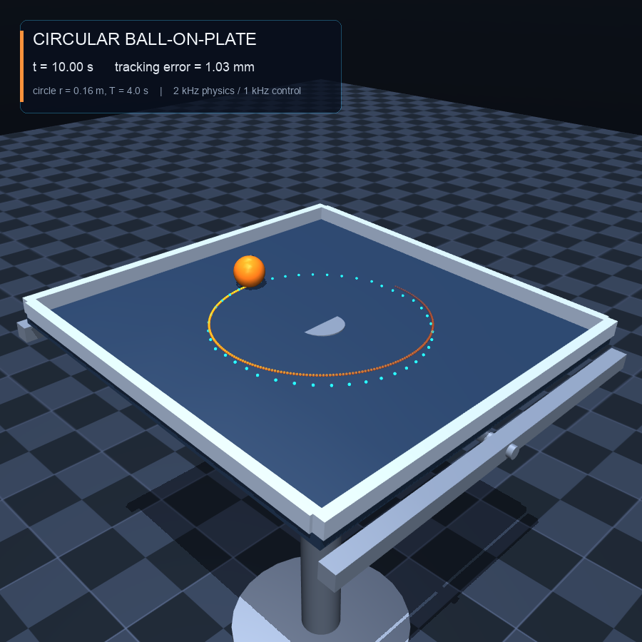

# MuJoCo 板球平衡：双轴板控制下的圆周轨迹

用 MuJoCo 搭建一个**真实接触动力学**的板球系统：球是带 free joint 的刚体，完全被动；板由两个铰链关节做俯仰/滚转，两个电机输出力矩。控制器根据球在板面内的位置/速度，解算需要的板倾角，让球从板中心平滑加速并稳定地做半径 0.16 m、周期 4 s 的圆周运动。



- 完整视频：[`outputs/ball_on_plate_circle.mp4`](outputs/ball_on_plate_circle.mp4)（20 s，900×900，60 fps）
- 循环预览：[`outputs/preview.gif`](outputs/preview.gif)（8 s，540×540）
- 结果曲线：[`outputs/tracking.png`](outputs/tracking.png)

## 项目背景

这是我在 **DeepSeek Harness** 上完成的第一个项目。它不只是生成了一段仿真代码，而是从 MuJoCo 的 MJCF 建模、接触与滚动约束、控制算法推导，一路做到可视化、指标评估和回归测试。最终球在真实接触仿真中达到了约 1 mm 的圆周跟踪误差，也让我直观感受到 DeepSeek Harness 对物理仿真器这类任务的理解能力。

## 结果

稳定段（12.4–20 s）的跟踪结果：

| 指标 | 数值 |
|---|---:|
| 圆周半径 | 0.160 m |
| 位置 RMS 误差 | **1.02 mm**（半径的 0.64%） |
| 位置最大误差 | 1.03 mm |
| 径向 / 切向 RMS | 0.49 / 0.90 mm |
| 相位滞后 | 0.32° |
| 最大板倾角 | 3.56° |
| 最大关节力矩 | 0.137 N·m（电机限幅 ±6 N·m） |
| 接触滑移速度 RMS | 0.79 mm/s |
| 接触法向力 | 约 0.44 N（球重 0.045 kg） |

> 这里的误差是 MuJoCo 中球的实际位置与参考位置之差。球没有被“绑定”到轨迹上：所有运动都来自板面接触、摩擦和滚动约束。

## 快速开始

```bash
cd ball_on_plate_mujoco
python3 -m venv .venv
source .venv/bin/activate
pip install -r requirements.txt

# 20 s 仿真，同时生成视频、GIF、曲线和 metrics
python simulate.py

# 只跑物理和控制，不渲染
python simulate.py --no-video

# 短一点的自检
python -m unittest -v test_smoke.py
```

macOS 上程序会自动设置 `MUJOCO_GL=cgl`。Linux 无显示器时，渲染前可设置：

```bash
MUJOCO_GL=egl python simulate.py
```

如果机器没有可用的 OpenGL，使用 `--no-video`，物理仿真、指标和曲线仍会正常生成。

## 物理模型

模型文件：[`ball_on_plate.xml`](ball_on_plate.xml)

```
world
└── base / 立柱
    └── pitch_body        hinge: pitch，绕世界 y 轴
        └── plate         hinge: roll，绕俯仰后的局部 x 轴
            ├── 板面      0.60 × 0.60 × 0.016 m，质量 1.20 kg
            ├── 四周挡边
            └── 参考圆点（纯视觉，无碰撞）
ball                       free joint，半径 0.025 m，质量 0.045 kg
```

关键点：

- 板不是 mocap，也不是运动学 body；它由两个**力矩电机**驱动。
- 球是 `freejoint` 刚体，**没有任何执行器**；它只受到重力和板面接触力。
- 接触使用 `condim="6"`，同时包含滑动、扭转和滚动摩擦：
  - 滑动摩擦系数 1.1
  - 扭转摩擦 0.0005
  - 滚动摩擦 0.00005
- 物理步长 0.5 ms（2 kHz），控制器 1 kHz。MuJoCo 使用 `implicitfast` 积分器和椭圆摩擦锥。
- 球在仿真中的滑移速度约 0.8 mm/s，说明 no-slip 滚动约束基本成立。

这是一个“板动、球被动”的真实动力学系统：板倾斜产生的重力分量驱动球滚动，球的惯性反作用力和接触力又作用回板，由关节电机闭环维持姿态。

## 控制算法

控制代码：[`controller.py`](controller.py)。采用串级结构。

### 1. 外环：滚动球动力学的反馈线性化

对均质实心球 \(I=\frac25 mr^2\)，无滑动滚动时：

\[
m a = m g_t - f,\qquad I\alpha = rf,\qquad a=r\alpha
\]

消去摩擦力得到：

\[
a=\frac57 g_t
\]

板姿态取 \(R=R_y(\beta)R_x(\alpha)\)，重力在板面内的分量为：

\[
g_x=g\sin\beta,\qquad g_y=-g\sin\alpha\cos\beta
\]

因此球在板面坐标下的加速度为：

\[
\ddot p_x=\frac57 g\sin\beta,\qquad
\ddot p_y=-\frac57 g\sin\alpha\cos\beta
\]

外环先由参考轨迹和 PD 反馈得到期望加速度：

\[
a_{cmd}=a_d+K_p(p_d-p)+K_d(v_d-v)
\]

再解析反解出板角：

\[
\beta_d=\arcsin\!\left(\frac{7a_{cmd,x}}{5g}\right),\qquad
\alpha_d=-\arcsin\!\left(\frac{7a_{cmd,y}}{5g\cos\beta_d}\right)
\]

这就是对滚动约束的反馈线性化，而不是直接给球写位置。控制量还做了倾角/加速度限幅，避免初始阶段或扰动时给出不可实现的姿态。

### 2. 内环：板姿态的关节 PD

\[
\tau = K_{p,j}(\theta_d-\theta)-K_{d,j}\dot\theta
\]

两个力矩再经过 ±6 N·m 饱和后送入 MuJoCo 的 `motor` 执行器。外环带宽远低于内环，因此可以认为板快速跟随期望倾角。

### 3. 参考轨迹

半径用五次 smootherstep 从 0 平滑增加到 0.16 m，持续 4 s；其一阶、二阶导数在起点和终点都为零，因此 \(t=0\) 时球从板中心静止出发，参考速度和加速度均为零：

\[
r(t)=R_0\,s(t/T_r),\qquad s(u)=6u^5-15u^4+10u^3
\]

\[
p_d=r\begin{bmatrix}\cos\omega t\\ \sin\omega t\end{bmatrix},\qquad
\omega=\frac{2\pi}{T}
\]

之后保持半径 0.16 m、周期 4 s 的逆时针圆周运动。

### 控制参数

| 参数 | 值 |
|---|---:|
| 外环 \(K_p\) | 60 s⁻² |
| 外环 \(K_d\) | 18 s⁻¹ |
| 内环 \(K_{p,j}\) | 140 N·m/rad |
| 内环 \(K_{d,j}\) | 18 N·m·s/rad |
| 最大倾角 | 0.30 rad |
| 最大指令加速度 | 2.0 m/s² |
| 力矩限幅 | ±6 N·m |

外环没有使用积分项。圆周跟踪中的主要稳态误差来自滚动摩擦造成的微小相位滞后（0.32°），通过提高内环刚度/带宽控制在毫米级。

## 输出文件

运行 `python simulate.py` 后：

| 文件 | 内容 |
|---|---|
| [`outputs/ball_on_plate_circle.mp4`](outputs/ball_on_plate_circle.mp4) | 20 s 三维仿真视频，含实时误差 HUD 和球轨迹拖尾 |
| [`outputs/preview.gif`](outputs/preview.gif) | 8 s 循环预览 |
| [`outputs/preview.png`](outputs/preview.png) | 单帧预览 |
| [`outputs/tracking.png`](outputs/tracking.png) | 平面轨迹、跟踪误差、板角、电机力矩 |
| [`outputs/trajectory.npz`](outputs/trajectory.npz) | 200 Hz 完整日志（位置、速度、角度、力矩、滑移等） |
| [`outputs/metrics.json`](outputs/metrics.json) | 全部指标 |

仿真日志中的位置/速度都在**板坐标系**下，和控制器使用的坐标一致。

## 代码结构

```
ball_on_plate_mujoco/
├── ball_on_plate.xml     # MuJoCo 物理模型（铰链、板、自由球、接触、电机）
├── controller.py         # 参考轨迹、状态读取、串级控制器
├── simulate.py           # 仿真主循环、日志、指标、视频/GIF
├── plotting.py           # 结果曲线
├── test_smoke.py         # 端到端跟踪自检
├── requirements.txt
└── outputs/
```

## 实现说明与可扩展方向

- 外环使用的是准静态滚动模型，忽略了板角速度和角加速度带来的 Coriolis/惯性耦合项。本轨迹下板角速度峰值约 0.12 rad/s、倾角约 3.6°，这些项较小；1 mm 的跟踪误差也验证了该近似在这个工作点足够。
- 如果需要更激进的轨迹（更高频率、更大半径、快速换向），可以把外环替换为基于完整刚体动力学的 MPC / 计算力矩控制，或把板的角速度项加入前馈。
- 迁移到真机时，需要辨识滚动阻力、接触摩擦、电机带宽和传感器延迟；可以在此基础上加入积分项、扰动观测器或自适应摩擦补偿。
- 当前球和板都是刚体，接触是点接触。若研究软球/软板，可替换为 MuJoCo 的 flex/soft 模型或外部 FEM/MPM 耦合。
